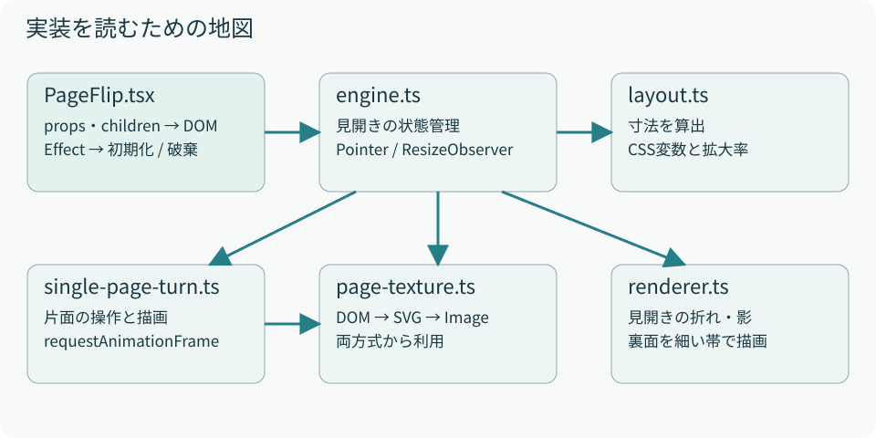

# 01　全体像をつかむ

読むファイル：PageFlip.tsx → engine.ts → renderer.ts / single-page-turn.ts

PageFlipは、Reactの子要素を「本の各面」として並べ、Canvasで紙のめくれ方を描くコンポーネントです。すべてをCanvasで表示する方式ではありません。**文字やレイアウトを作るHTMLと、折れ・影・裏面を描くCanvasを組み合わせています。**

デスクトップでは右側の表面をDOMで見せ、めくるにつれてその表示幅を狭めます。その上に折れた紙をCanvasで描くと、次の面が下から現れます。左側へ着地した裏面もCanvasで表示します。

モバイルの片面表示では、普段は1面だけをDOMで表示します。横スワイプを始めたときに現在の面と次の面を画像化し、一時的にCanvasへ置き換えます。めくりが終わるとDOMへ戻します。この違いを最初に押さえると、2つの描画処理を混同せずに読めます。

<figure><figcaption>図1　エンジンが操作をまとめ、見開きと片面がそれぞれの描画処理を持つ。図中の線は主要な呼び出し関係を示す。</figcaption></figure>

## ファイルごとの責務

| ファイル | 入力と役割 | 読むときの注目点 |
| --- | --- | --- |
| `PageFlip.tsx` | propsとchildrenを受け取る公開API | Reactの再描画とEffectの依存配列 |
| `layout.ts` | 本とCanvasの寸法、縮小率 | 基準サイズと実際の表示サイズの区別 |
| `engine.ts` | 紙ごとの進捗、Pointer、表示モード | `currentPage`は面番号ではない |
| `renderer.ts` | 見開きの折れた紙と影 | 背表紙を原点にした座標 |
| `single-page-turn.ts` | 片面スワイプと一時Canvas | 画像読込と操作終了の前後関係 |
| `page-texture.ts` | DOMからImageへの変換 | CSSとDOM状態の違い |
| `style.css` | ページ配置、モード別サイズ、表示切替 | `data-layout`とクラスの役割 |

## パッケージとデモの境界

`packages/page-flip`には再利用する処理を置きます。`src/App.tsx`は利用例で、表紙や本文を渡します。表紙の深緑、文字サイズ、文章の余白は`src/style.css`の責務です。パッケージを別アプリで使っても、これらのデモ装飾は自動では付いてきません。

パッケージの`exports`はTypeScriptソースとCSSを公開しています。現時点ではワークスペース内でViteなどから利用するソースパッケージであり、配布用JavaScriptや型宣言を独立して生成するnpm公開工程は含みません。

## この本の読み方

利用するだけなら第2章と第8章、挙動を変更するなら第3〜7章を読みます。制約や不具合を調べるときは第9章、変更後の確認は第10章が入口です。図は理解のために簡略化しています。式や定数は現行コードを基準とし、抜粋コードを省略した箇所は本文で明示します。
