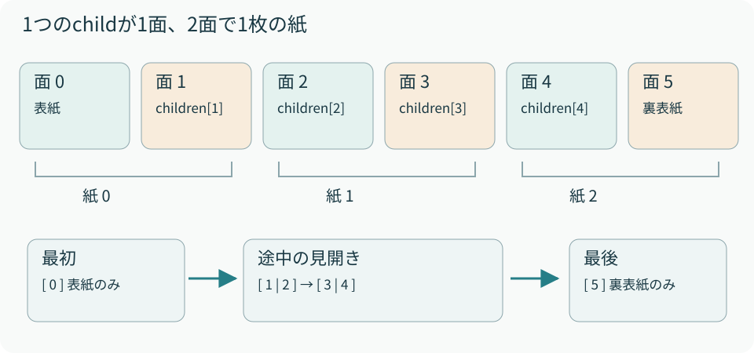

# 02　propsと「面」の設計

<p class="source">読むファイル：packages/page-flip/src/PageFlip.tsx、src/App.tsx</p>

`PageFlip`の直下に置く子要素は、1つが1面です。最初の面が表紙、最後が裏表紙になります。面を2つずつ組み合わせて、1枚の紙を表現します。例えば6面なら、紙は3枚です。

```tsx
import { PageFlip } from "@book-effects/page-flip";
import "@book-effects/page-flip/style.css";

const Example = () => (
  <PageFlip pageWidth={516} canvasPadding={30}>
    <div>表紙</div>
    <div>表紙の内側</div>
    <article>本文の表</article>
    <article>本文の裏</article>
    <div>裏表紙の内側</div>
    <div>裏表紙</div>
  </PageFlip>
);
```

<figure><figcaption>図2　「紙の表裏」と「画面に並ぶ見開き」は別の組み合わせ。見開きの左右は隣り合う別々の紙に属する。</figcaption></figure>

## props一覧

| props | 既定値 | 意味・単位 |
| --- | --- | --- |
| `children` | 必須 | 読む順の面。2面以上の偶数 |
| `pageWidth` | `516` | 1面の基準幅。CSS px |
| `canvasPadding` | `30` | 見開きCanvasの周囲の描画余白。CSS px |
| `pageRatio` | `5 / 7` | 幅÷高さ。高さは幅をこの値で割る |
| `mobileBreakpoint` | `700` | 片面に切り替える外側コンテナの幅。px |
| `isSE` | `false` | めくり確定時のSE。Web Audioで紙の音を合成 |
| `initialPage` | `0` | 初期面番号。0始まり |
| `onPageChange` | 未指定 | 確定した面番号を受け取る通知関数 |
| `className` / `style` | 未指定 | 外側コンテナへの装飾と寸法指定 |
| `aria-label` | ページをめくる本 | 外側sectionのアクセシブル名 |

## 子要素を紙にまとめる手順

まず`Children.toArray(children)`で配列化し、各子をFragmentで包みます。これは新しいHTML要素を増やさずに、Reactが組み立てたkeyを面に持たせるためです。紙を描画するときは、先頭側の面のkeyを`.bf-sheet`に使います。

```tsx
// 対応関係を説明するための抜粋
const sheet = {
  front: faces[index * 2],
  back: faces[index * 2 + 1],
};
```

配列の子要素は並べられますが、利用側が渡したFragmentや独自コンポーネントの内部を再帰的に「面」へ分割することはしません。`<Article />`が複数の段落を返しても、それらを含む1面です。空白面は`<div />`として明示します。動的配列には利用側で安定したkeyを付けると、並び替え時に意図が保たれます。

## 入力検証とページ番号

幅と比率は有限の正数、Canvas余白と切替幅は有限の0以上の値です。面数が奇数、または`initialPage`が有効範囲外なら描画時に例外を投げます。`initialPage`は制御用propsではありません。後から値を変えても、その面へ移動する命令にはなりません。

片面の`onPageChange`は表示面番号を返します。見開きでは左面の番号を返し、表紙だけのときは0です。通知は見開きの収束後、または片面の確定時に呼ばれます。見開きのキャンセル操作でも同じ番号が通知され得るため、通知回数をそのまま「読んだページ数」として数えないでください。
