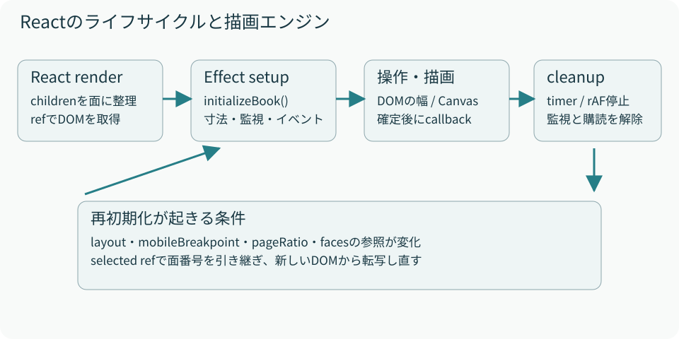

# 03　Reactと命令的描画をつなぐ

読むファイル：PageFlip.tsx のref / Effect、engine.ts の戻り値

ReactはDOM構造を作り、エンジンはそのDOMの幅やクラスとCanvasを操作します。アニメーションの全フレームをReact stateに入れる実装ではありません。頻繁に変わる数値は、`initializeBook`や`createSinglePageTurn`が作るクロージャの中に保持します。

<figure><figcaption>図3　初期化と後始末を1組にする。StrictModeでsetup→cleanup→setupが起きても、購読やCanvasを重複させないことが重要。</figcaption></figure>

## refに入れるもの

| ref | 用途 |
| --- | --- |
| `viewport` | サイズを観測する外側section |
| `book` | ページとCanvasの座標基準になるdiv |
| `canvas` | Reactが作る見開き用Canvas |
| `selected` | 再初期化へ引き継ぐ確定面番号 |
| `callback` | 最新の`onPageChange`関数 |

`callback`を別のEffectで更新することで、通知関数の参照が変わっただけではエンジンを作り直しません。一方、`layout`、`mobileBreakpoint`、`pageRatio`、`faces`が変わると初期化Effectが再実行されます。

`faces`はchildrenの参照から作ります。親が新しいJSXを渡すと、内容が見た目上同じでも再初期化が起き得ます。確定済み面はrefから戻せますが、めくっている途中の形は再開しません。内部stateだけを更新する子コンポーネントでは、親の`faces`が変わらないこともあり、デスクトップの転写画像が自動更新されない点に注意します。

## 初期化の中身

`initializeBook`はCanvasの2D contextを取得し、寸法をCSS変数へ反映します。その後、`.bf-sheet`ごとに`progress`、`target`、裏面画像を持つオブジェクトを作ります。ページ要素を探すセレクタはbookの直下に限定されており、本文中にsectionが含まれても別の紙として数えません。

見開きと片面の両方の操作処理を準備し、外側幅をResizeObserverで観測します。モードを初期設定した後、見開きの描画タイマーとPointerイベントを登録します。モードが片面の間は、見開きのrenderは冒頭でreturnします。

## cleanupが解放する資源

| 資源 | 初期化 | 後始末 |
| --- | --- | --- |
| 見開きタイマー | `setInterval` | `clearInterval` |
| 寸法・モード監視 | 2つのResizeObserver | それぞれ`disconnect` |
| Pointerイベント | `addEventListener` | 同じ関数参照で解除 |
| 片面フレーム | `requestAnimationFrame` | `cancelAnimationFrame` |
| 片面Canvas | DOMへ追加 | `remove` |
| 非同期転写結果 | Image読込 | `disposed` / `generation`で古い結果を無効化 |

見開き側の`disposed`はcleanup後の画像反映を止めます。片面側の`generation`は処理の世代番号で、resetのたびに増えます。画像が後から読み込まれても開始時の番号と違えば採用しません。どちらもネットワークや画像デコード自体を中断するものではなく、完了結果を使わないための仕組みです。

ReactのEffectの考え方は[公式のuseEffectリファレンス](https://react.dev/reference/react/useEffect)に沿っています。本実装では、エンジンの戻り値をそのままEffectのcleanupとして返しています。
