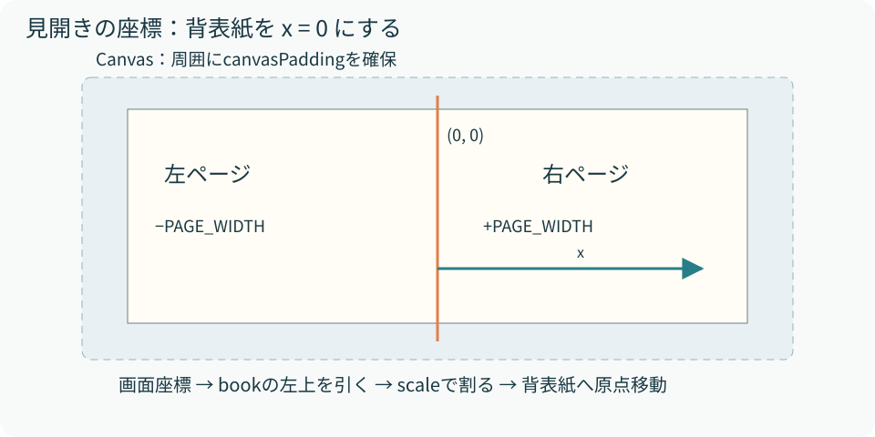

# 04　寸法と座標を読み解く

<p class="source">読むファイル：layout.ts、engine.ts のgetPosition、style.css</p>

レイアウトでは「元の寸法」と「画面上の寸法」を分けます。見開きは固定の設計寸法を作ってからCSS transformで全体を縮小します。片面表示はCSSで実幅を決め、本文をその幅で折り返し直します。

## 基準寸法の算出

```ts
const PAGE_WIDTH = pageWidth;
const PAGE_HEIGHT = pageWidth / pageRatio;
const BOOK_WIDTH = PAGE_WIDTH * 2 + 30;
const BOOK_HEIGHT = PAGE_HEIGHT + 10;
const PAGE_Y = 5;
```

既定値ではページが516×722.4px、本の基準領域が1062×732.4pxです。余白30pxを両側へ加えると、Canvasの計算上の寸法は1122×792.4pxになります。Canvasのwidth/height属性に小数を代入した際の整数化と、CSS上の小数寸法は区別してください。

ここにある`30`と`10`は本の基準領域に加える固定余白で、propsの`canvasPadding`とは別です。`canvasPadding`を変更しても、本文の内側の余白や本の綴じ方は変わりません。

<figure><figcaption>図4　図は概念図。Canvasには周囲の余白があり、描画前のtranslateで背表紙の上端を原点にする。</figcaption></figure>

## 見開きの拡大率

`fitBookToViewport`は外側コンテナから上下左右16px分の余裕を引き、幅・高さの両方に収まる最小の倍率を採用します。

```ts
const scale = Math.min(
  1,
  availableWidth / (BOOK_WIDTH + CANVAS_PADDING * 2),
  availableHeight / (BOOK_HEIGHT + CANVAS_PADDING * 2),
);
```

現行の上限は1です。十分に広いデスクトップでも基準寸法より拡大しません。値は`--book-scale`へ渡されます。この倍率はCanvasだけでなく、本全体へ適用されるため、DOMの文字と折れた紙の位置関係が揃います。

## 指の位置を本の座標へ戻す

PointerEventのclientX/clientYは画面座標です。`getBoundingClientRect()`で移動・拡縮済みのbook位置を取り、以下の順で逆変換します。

```ts
const scale = bounds.width / BOOK_WIDTH || 1;
const x = (event.clientX - bounds.left) / scale - BOOK_WIDTH / 2;
const y = (event.clientY - bounds.top) / scale - PAGE_Y;
```

これでxが負なら左面、正なら右面です。yがページ高の外側、またはxの絶対値がページ幅以上なら操作を開始しません。表紙・裏表紙を中央へ寄せるtranslateもrectに反映されるため、中央寄せの移動量をイベント側で別途足し引きする必要はありません。

描画側の原点は`CANVAS_PADDING + BOOK_WIDTH / 2`、`PAGE_Y + CANVAS_PADDING`だけ移動します。イベント側は画面から本へ、Canvas側は画像の左上から背表紙へ、という逆向きの処理です。
