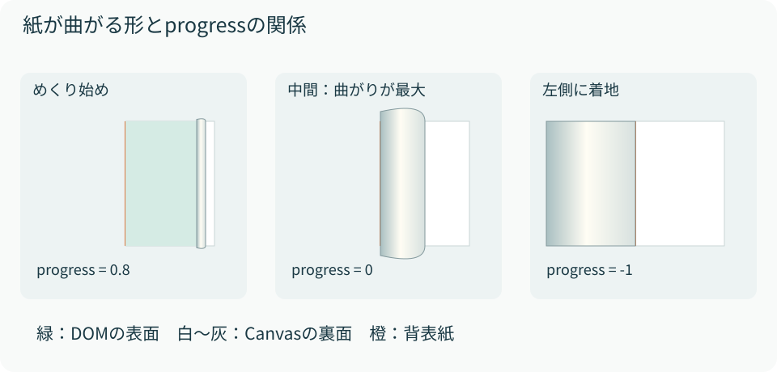

# 05　見開きのページをめくる

<p class="source">読むファイル：engine.ts のPointer処理とrender、renderer.ts のdrawFlip</p>

見開きの単位は「面」ではなく「紙」です。各紙がDOMの表面、画像化した裏面、現在の折れ位置を持ちます。`progress = 1`なら右側に閉じ、`-1`なら左側へめくり終わった状態です。

## 状態変数と操作の流れ

| 状態 | 意味 |
| --- | --- |
| `currentPage` | 左へめくり終えた紙の枚数。面番号ではない |
| `activeFlip` | 現在ドラッグしている紙のindex。未操作ならnull |
| `activePointer` | 操作中のPointer ID |
| `mouseX` | 背表紙を0にした指・マウスのx座標 |
| `progress` | 現在描画している位置 |
| `target` | 指の位置、または着地先の位置 |
| `pendingPage` | 収束後に親へ通知する面番号 |

右側を押すと`currentPage`の紙、左側を押すとその1枚前を選びます。Pointer Captureにより、ドラッグ中に紙の外へ出てもbookがイベントを受け取れます。すでにドラッグ中、または前のアニメーションが収束していない場合は新しい操作を受け付けません。

ドラッグ中のtargetは`mouseX / PAGE_WIDTH`を−1〜1に制限した値です。指を離したときはxが負なら−1、正なら1に確定します。片面方式のような移動距離のしきい値ではなく、**離した位置が背表紙のどちら側か**で判定します。

## targetへ徐々に近づける

`setInterval`で約60回/秒renderを呼び、次の補間を行います。フレーム間隔の実測時間を使う方式ではないため、負荷が高いと体感速度は変わり得ます。

```ts
progress += (target - progress) * 0.2;
// ドラッグしていない場合、差が0.003未満なら完全一致させる
```

例えばprogressが1、targetが−1なら、更新後は0.6、0.28、0.024…となります。差の20%ずつ近づけることで急停止を避けます。差が十分小さくなったらtargetを直接代入し、端点で無限に小さな差が残ることを防ぎます。

## DOMの表面とCanvasの裏面

表面の表示幅は`PAGE_WIDTH × (1 + progress) / 2`です。幅を変えるのは紙を包む`.bf-sheet`だけで、内側の`.bf-face`の幅は固定です。本文の改行を変えずに右端を隠せます。

<figure><figcaption>図5　表面DOMのクリッピングと裏面Canvasの形を同じprogressから計算することで、境界が揃う。</figcaption></figure>

## 折れた紙の形を作る式

Wをページ幅、pをprogressとした式です。`strength`は端点で0、中間で1になります。

```text
strength = 1 − |p|
foldWidth = W × 0.5 × (1 − p)
foldX = W × p + foldWidth = W × (1 + p) / 2
verticalOutdent = 20 × strength
```

| p | 表面の表示幅 / foldX | 折れ幅 | 紙の左端 |
| --- | --- | --- | --- |
| 1 | W | 0 | W |
| 0 | W / 2 | W / 2 | 0 |
| −1 | 0 | W | −W |

紙の輪郭は直線と二次ベジェ曲線で閉じます。上下の制御点を`verticalOutdent`に応じて外へ膨らませると、中間だけ紙がたわみます。これは3Dメッシュや物理シミュレーションではなく、2Dの輪郭とグラデーションによる表現です。

## 裏面を細い帯に分けて曲げる

裏面のImageを折れ幅に合わせて1px程度の縦帯に分割し、帯ごとに縦位置と高さを変えて`drawImage`します。輪郭でclipしているので、帯が紙の外へはみ出しません。画像のnaturalWidth/naturalHeightを使うため、高密度で作成した転写画像も全体を正しく参照します。

最後に紙の陰影を薄く重ね、輪郭線を描きます。帯の本数は折れ幅に比例するため、大きなpageWidthや多くの同時描画はコストが増えます。描画順は「左へ着地済みの最上面」→「動いている紙」です。これにより操作中の紙が下へ潜りません。

表紙を閉じた状態では本を左へW/2だけ寄せ、右面だけを中央にします。裏表紙では右へW/2寄せます。移動量も最初と最後のprogressから計算するため、開閉の途中で中央位置が連続的に変わります。
