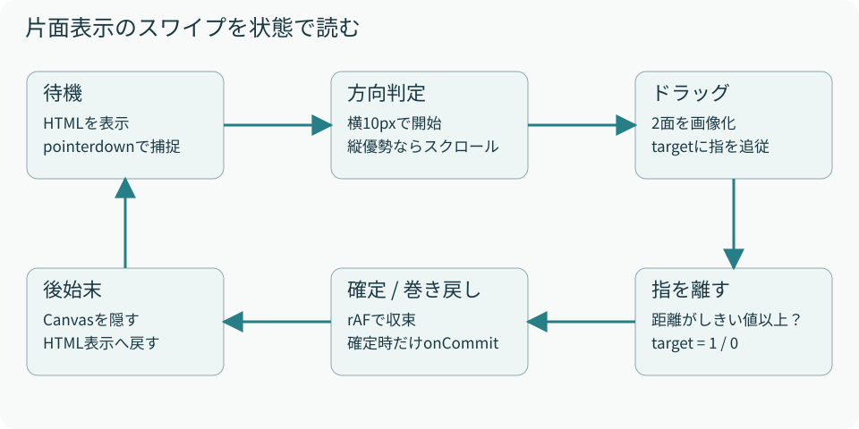

# 06　片面表示のスワイプ

<p class="source">読むファイル：single-page-turn.ts、engine.ts のshowFace / updateMode</p>

片面表示では、面番号を1つずつ増減させます。紙の表を見た次はその裏、その次が次の紙の表です。見開きと同じ`drawFlip`を縮めているのではなく、片面専用の描画を行います。

`showFace`は、面番号を2で割って該当の紙に`is-current`を付け、偶数なら`data-face="front"`、奇数なら`back`にします。CSSがそれ以外の紙と面を非表示にするため、静止中は1面のHTMLだけが見えます。

<figure><figcaption>図6　状態名は説明用。コードではpointer・busy・ready・released・targetなどの変数の組み合わせで表す。</figcaption></figure>

## 縦スクロールと横スワイプを分ける

bookとスクロール可能な面に`touch-action: pan-y`を指定します。縦操作はブラウザのスクロールに任せ、横操作をページめくりとして扱います。スクロール領域自身にもこの指定を持たせることが、横操作をブラウザへ奪われないために重要です。

pointerdownでは開始座標を保存し、bookがPointerを捕捉します。方向が未確定の間は、縦移動が12pxを超えて横移動より大きければページ操作から離脱します。横移動が10px未満なら判定を待ちます。それを超えると左向きなら次面、右向きなら前面を選びます。

## 画像化中に指を離しても成立する

`start`は現在面を画像化し、面番号を一時的に次面へ変えて次面も画像化してから、面番号を元へ戻します。この準備は`onCommit`を呼びません。画像の読込は非同期なので、指を離すイベントが先に来ることがあります。

そのため「画像が使えるか」を`ready`、「指を離したか」を`released`として分けています。読込後に`tick`を始めれば、すでに設定された確定先へ収束できます。`busy`は重複する開始を防ぎます。

```ts
// 横移動と確定しきい値の要点
target = clamp(-dx * direction / width, 0, 1);
const threshold = Math.min(60, book.clientWidth * 0.2);
// pointerupの最終座標から測った移動距離がthreshold以上なら確定
```

既定の面幅でしきい値が60pxになる場合、約60px以上の有効方向の移動で次面へ進みます。幅が300pxより小さければ、しきい値は幅の20%です。最後のpointermoveだけに頼らず、pointerupの座標で移動量を計算するため、短時間のスワイプも判定できます。

## Canvasが描く3つの層

まず次面を全面に描き、その上へ現在面をclipして重ね、最後に曲がった帯と影を描きます。progressは0から1で、折れの境界は`width × (1 − progress)`です。巻き上がる帯の幅は以下のように途中で膨らみ、端点では消えます。

```ts
const curl = Math.min(
  fold,
  Math.sin(progress * Math.PI) * width * 0.32,
);
```

戻る方向では折れと影の座標を左右反転します。本文画像自体は反転させないため、文字が鏡文字にはなりません。**現行の片面の折れ帯には裏面テキストを描かず、紙色のグラデーションを使います。** 次の内容は下に敷いた面として現れます。見開きの裏面転写との重要な違いです。

描画ループはrequestAnimationFrameで実行し、progressをtargetへ22%ずつ近づけます。差が0.003未満に収束すると、確定なら面番号を変更して`onCommit`を呼び、resetします。巻き戻しなら面番号は維持します。

## 中断とサイズ変更

pointercancelやbook自身の捕捉喪失ではtargetを0へ戻します。子要素から伝わったlostpointercaptureを区別することで、捕捉先をbookへ移しただけでキャンセルしないようにしています。

resetはフレーム予約と操作状態を破棄し、Canvasを隠してHTMLを再表示します。windowのresizeとモード切替でも呼びます。ただし、同じモードのまま親コンテナだけが変形するケースはwindow.resizeとは別です。埋め込み先でそのようなサイズ変更を行う場合は、実際の操作中の挙動も確認します。
