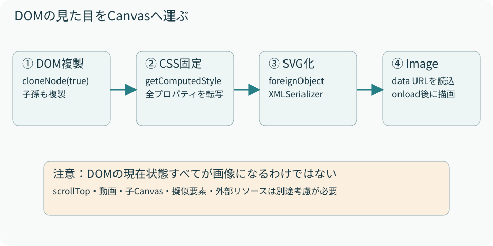

# 07　HTMLをCanvasの画像へ変える

<p class="source">読むファイル：page-texture.ts、renderer.ts のdrawImage、single-page-turn.ts のsnapshot</p>

Canvasの2D APIへHTML要素を直接渡して描くことは、この実装では行っていません。DOMを複製してCSSを固定し、SVGのforeignObjectに包んだImageを作ります。ここでいう「テクスチャ」は、このImageを指します。

<figure><figcaption>図7　画像化の境界を越えると、元のReactコンポーネントやイベントは画像には引き継がれない。</figcaption></figure>

## ① DOMを深く複製する

`cloneNode(true)`で対象の面と子孫を複製します。元要素と複製の子孫をそれぞれ配列にし、同じindex同士を対応付けます。ここで複製するのはDOMツリーです。React state、イベントリスナー、スクロール位置などを丸ごと保存する操作ではありません。

## ② 計算済みのCSSを固定する

元要素ごとに`getComputedStyle`を呼び、列挙できるCSSプロパティを複製側のinline styleへ書き込みます。外部CSSのセレクタがSVG内で効かなくても、文字色やサイズなどを持ち運ぶためです。

```ts
originals.forEach((original, index) => {
  const style = getComputedStyle(original);
  for (const property of Array.from(style)) {
    copies[index].style.setProperty(
      property, style.getPropertyValue(property),
    );
  }
});
```

裏面は通常DOM上で非表示なので、複製のルートだけ`display: block`にします。ルートの幅と高さも引数で固定し、XHTMLの名前空間を指定します。子孫のdisplayは元の計算結果のままです。非表示の祖先を持つ要素の寸法計算は、通常表示中のDOM計測と全く同じとは限りません。

## ③ SVGに包んでImageとして読む

`XMLSerializer`でHTMLを文字列にし、SVG内のforeignObjectに挿入します。文字列をURIエンコードしたdata URLをImage.srcへ渡します。返すPromiseはImage.onloadで解決し、onerrorではrejectします。読み込み前のImageを描こうとしないことが大切です。

```text
svg
└─ foreignObject（幅100%、高さ100%）
   └─ 複製した面（inline style付きHTML）
```

## CSS pxと画像の画素数

倍率は`min(devicePixelRatio || 1, 3)`です。例えばCSS幅300px、DPR=2なら、SVGの画像幅は600、viewBox幅は300になります。文字のレイアウトは300px基準のまま、より多くの画素へ転写できます。

片面Canvasも同じ上限3倍でバッファを確保し、context.setTransformで描画座標をCSS pxへ合わせます。見開きでは裏面Imageは高密度ですが、Canvas本体の幅・高さは基準寸法のままです。両モードでCanvasのDPR対策が完全に同じというわけではありません。

## いつ画像を作るか

見開きでは初期化やモード移行の際、`document.fonts.ready`を待って各裏面を作ります。片面ではスワイプ開始ごとに現在面と次面を作ります。後者は直前のDOMを使える反面、長いDOMツリーと多くのCSSプロパティを複製するコストが操作開始時に発生します。

画像転写中に元のpropsや表示モードが変わり得るので、描画へ採用する前に寿命の確認が必要です。現在は見開きでdisposed、片面でgenerationを使っています。スクロール位置の転写制限は第9章で具体的に説明します。
