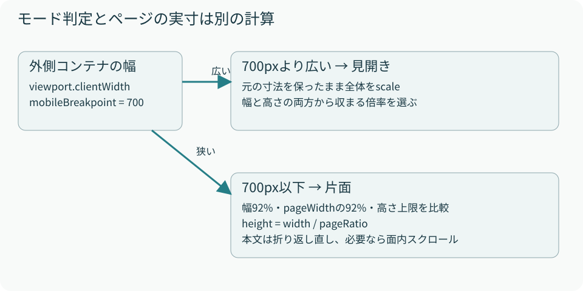
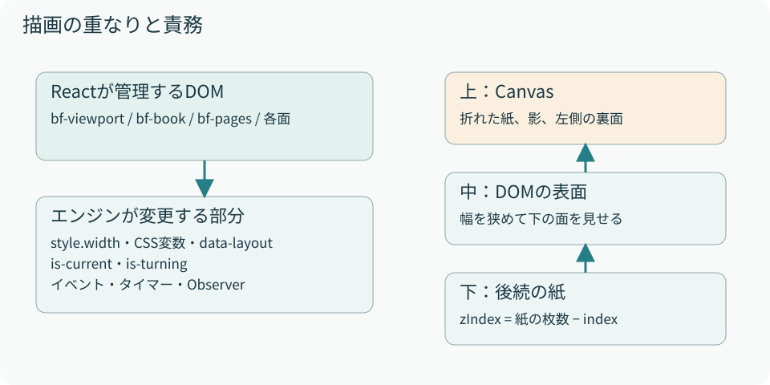

# 08　レスポンシブとスタイルの境界

<p class="source">読むファイル：packages/page-flip/src/style.css、src/style.css</p>

片面へ切り替える基準はウィンドウ幅そのものではなく、コンポーネント外側の`clientWidth`です。大きな画面でも、狭いカラム内に配置すれば片面になります。ResizeObserverで観測し、`data-layout="single"`または`spread`を付けます。CSSの固定メディアクエリだけで判定していないため、propsの切替幅がそのまま使えます。

<figure><figcaption>図8　モード判定は幅だけ。実際の見開きサイズは幅と高さ、片面サイズは幅の割合と画面高上限で決まる。</figcaption></figure>

## 片面のサイズ計算

現在は少し余裕を持たせるため、幅を92%にしています。最大幅にも基準ページ幅の92%を使い、さらに画面の高さに基づく上限を設けます。

```css
.bf-book[data-layout="single"] {
  width: 92%;
  max-width: min(
    calc(var(--page-width) * 0.92),
    calc((100dvh - 64px) * var(--page-ratio))
  );
  aspect-ratio: var(--page-ratio);
}
```

幅390pxの外側コンテナで、左右paddingが各12pxなら内幅は366pxです。その92%は約336.7px、比率5:7なら高さは約471.4pxになります。画面高の上限やpageWidth側の上限がこれより小さければ、そちらを採用します。

現在の外側paddingは`5vh 12px`です。高さ上限から引く64pxと上下合計10vhは、同じ値ではありません。別アプリのヘッダーや親の余白もこの式には含みません。したがって、すべての埋め込み先で外側スクロールが必ず消える保証ではなく、コンテンツ領域全体の高さと合わせて確認する必要があります。

## 面内スクロールとページ全体の縮小

片面は幅に合わせてDOMが折り返されます。文字サイズを自動で縮小する処理はパッケージにありません。デモの17pxはデモ側のCSSです。面より内容が長ければ`.bf-face`の`overflow-y: auto`により、面の内側がスクロールします。

本全体を小さくすると外側のスクロールは減りますが、面の表示領域も小さくなるので、内部スクロールが増える可能性があります。この2種類のスクロールを区別してサイズを調整します。

<figure><figcaption>図9　コンポーネントの構造と描画の重なり。装飾用のCSSはこの配置を壊さない範囲で追加する。</figcaption></figure>

## 利用側の装飾

ページの子要素へ独自classNameを付けて装飾します。パッケージの`.bf-*`クラスは配置と動作のためのクラスです。上書きする場合は、そのスタイルがどのモードで必要かを確認してください。

```tsx
const Book = () => (
  <PageFlip className="catalog" style={{ height: 720 }}>
    <article className="catalog-cover">表紙</article>
    <article className="catalog-page">裏表紙</article>
  </PageFlip>
);
```

```css
.catalog-page, .catalog-cover {
  box-sizing: border-box;
  min-height: 100%;
  padding: 24px;
}
.catalog-cover { background: #203c46; color: #f3e5bf; }
```

見開きのDOM幅はエンジンがinline styleで変更します。片面へ切り替える際はそのwidthを削除してからCSSの100%を適用します。`!important`で上書きしないため、モード切替時の後始末もレイアウトの一部です。
