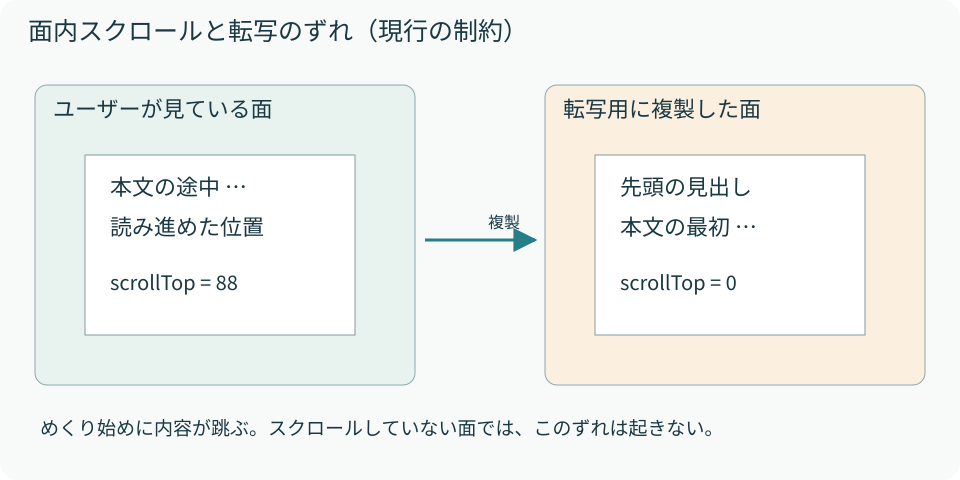

# 09　現行実装の制約を理解する

読むファイル：page-texture.ts、PageFlip.tsx、engine.ts。ここは修正案と現行挙動を区別して読む。

このコンポーネントは、静的なHTMLテキストとCSS中心のページに向いた実装です。DOMと画像を切り替える以上、Reactの子要素を渡せることと、そのすべての状態・操作がCanvasへ完全に移ることは別です。

## スクロール位置は転写されない

`cloneNode(true)`と計算済みCSSの転写では、スクロール位置は画像へ保存されません。`scrollTop`はスタイルではなくDOMの状態です。複製をSVGへ直列化しても、その値が表示位置として残るわけではありません。

<figure><figcaption>図10　320px幅で確認した例では、面の表示高約381pxに対し内容が約469pxあり、88pxスクロールできた。数値は確認時の内容・寸法に依存する。</figcaption></figure>

ユーザーが縦に読み進めてから横へめくると、静止中のHTMLとCanvas上の画像で見える位置が違い、先頭へ跳んだように見えます。スクロールしていない面では、この原因によるずれは起きません。修正する場合は、元のscrollTopを読んで内容をその分移動し、可視領域でclipした画像を作る方法などを検討します。**この補正は現行コードには実装されていません。**

## 画像へ転写した面の操作

Canvas上の文字やボタンは、ReactのDOM要素そのものではありません。デスクトップの左面はCanvas描画なので、そこに見えるリンクやフォームを元のDOMのようには操作できません。モバイルでは静止中はDOMへ戻りますが、操作イベントはbookでも監視しているため、入力部品を置くならクリック・選択・ドラッグの競合を別途検証します。

外部画像、Webフォント、動画、子Canvas、擬似要素も同じ精度で転写される保証はありません。data URL画像など、自己完結したリソースを使って対象ブラウザで確認するのが現実的です。ブラウザ間のSVG foreignObjectの扱いも確認対象になります。

## 更新と表示位置に関する現行挙動

今回の説明対象では、次の2点は既知の挙動として記録し、修正対象には含めていません。

- モバイルの偶数面を見た後、見開き→片面と往復すると、見開きの左面を選び直すことがあります。例えば面2から面1へ戻ります。
- `initialPage`の範囲検証は毎renderで行います。4面・initialPage=2の状態から2面へ減らすと、現在位置の補正に到達する前に例外になります。

これらを変更するときは、単なる描画修正ではなく「現在ページ」のAPI上の意味も合わせて決める必要があります。現在のREADMEにある「初期値」と、更新時の検証の実際を区別して扱います。

## 性能を見るポイント

| 処理 | コストが増える条件 | 最初に見る箇所 |
| --- | --- | --- |
| CSS転写 | 深いDOM、多数の子孫 | `getComputedStyle`と全プロパティ複製 |
| 見開き描画 | 大きなpageWidth、多数の紙 | 毎フレームの全紙走査と縦帯描画 |
| 片面の画像 | 高DPR、大きな実寸 | ImageとCanvasの画素数 |
| 再初期化 | 親が頻繁にchildrenを作り直す | Effectのfaces依存 |

現行の見開きは静止中もタイマーが動きます。最適化するなら、静止フレームの停止、画像のキャッシュ、必要なときだけ再転写する設計などが候補です。ただし、キャッシュには内容更新・フォント・サイズ変更時の無効化も必要になります。
